# 一篇文章带你了解仓颉所有开发套件获取及安装

**仓颉编程语言通用版本(服务端等领域开发)**

[仓颉通用版本申请链接](https://wj.qq.com/s2/14870499/c76f/)（申请前建议优先看注意事项）

[仓颉 Linux Beta 版本下载链接](https://gitcode.com/Cangjie/CangjieSDK-Linux-Beta) （通过申请后可见）

[仓颉 Windows Beta 版本下载链接](https://gitcode.com/Cangjie/CangjieSDK-Win-Beta) （通过申请后可见）

[仓颉 Mac Beta 版本下载链接](https://gitcode.com/Cangjie/CangjieSDK-Darwin) （通过申请后可见）

[仓颉 VScode Plugin Beta 版本下载链接](https://gitcode.com/Cangjie/CangjieVScodePlugin) （通过申请后可见）

[仓颉编程语言通用版本官方文档下载链接](https://gitcode.com/Cangjie/CangjieDocs/overview) （通过申请后可见）

[仓颉编程语言通用版本开发者论坛](https://gitcode.com/Cangjie/UsersForum) （通过申请后可见）

**HarmonyOS NEXT 仓颉语言开发者预览版(鸿蒙原生应用开发)**

[HarmonyOS NEXT 仓颉语言开发者预览版申请链接](https://developer.huawei.com/consumer/cn/activityDetail/cangjie-beta/)（申请前建议优先看注意事项）

[DevEco Studio NEXT Developer Beta2-Cangjie Plugin 下载链接](https://developer.huawei.com/consumer/cn/download/) （HarmonyOS NEXT 仓颉语言开发者预览版申请后可见）

[仓颉鸿蒙原生应用开发者论坛](https://gitcode.com/Cangjie/CangjieMoBileUsersForm) （HarmonyOS NEXT 仓颉语言开发者预览版申请后可见）

## 1 注意事项

### 1.1 仓颉编程语言通用版本审核不过可能原因

#### 1.1.1 长时间没有收到官方回复邮件怎么办？

答：可能是由于签署姓名或输入“我已阅读、充分理解并同意以上保密要求及 《仓颉编程语言通用版本SDK用户使用和保密知情同意书》”环节存在问题，也可能是由于您的邮箱无法收到我们发送的邮件，建议您重新填写！

#### 1.1.2 收到邮件长时间没有加入社区怎么办？

答：可能是由于您未点击申请加入社区链接（建议您点击后稍作等待1天），或您问卷中填写的的手机号与您gitcode账号绑定的手机号不一致导致（建议您重新填写或换绑手机）！

### 1.2 HarmonyOS NEXT 仓颉语言开发者预览版审核不过可能原因

#### 1.2.1 长时间没有收到官方回复邮件怎么办？

答：可能是由于姓名以及相关信息填写不规范，建议您重新填写！

#### 1.2.2 收到邮件长时间没有加入社区怎么办？

答：可能是由于您未点击申请加入社区链接（建议您点击后稍作等待1天），或您招募活动中填写的的手机号与您gitcode账号绑定的手机号不一致导致（建议您重新填写或换绑手机）！

## 2 仓颉编程语言通用版本开发环境搭建（以 Windows 平台为例）

### 2.1 下载 VScode 以及 仓颉语言 VScode 插件

IDE下载这里不做赘述，点击[仓颉语言 VScode 插件](https://gitcode.com/Cangjie/CangjieVScodePlugin/overview)进入代码仓下载并解压缩

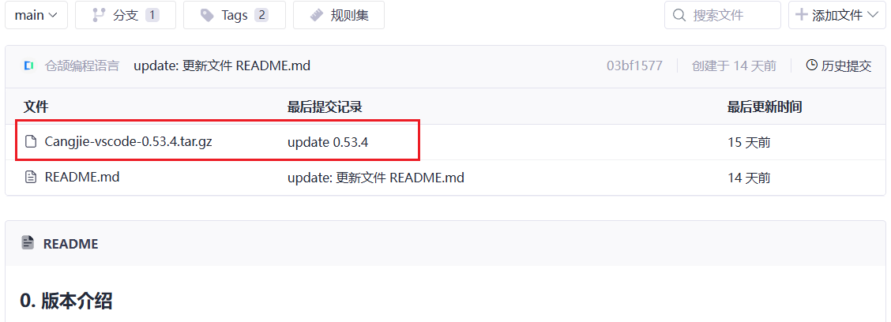

### 2.2 下载仓颉编程语言通用版本SDK

点击[仓颉编程语言通用版本SDK（Windows）](https://gitcode.com/Cangjie/CangjieSDK-Win-Beta)进入代码仓下载并解压缩

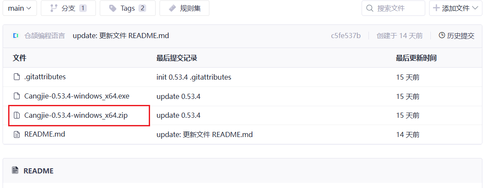

建议点击后跳转页面右上角下载按钮下载，或使用`git lfs clone ...`进行下载

### 2.3 配置环境

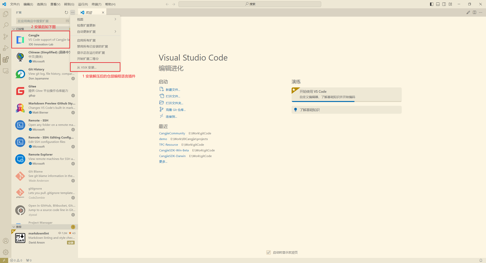

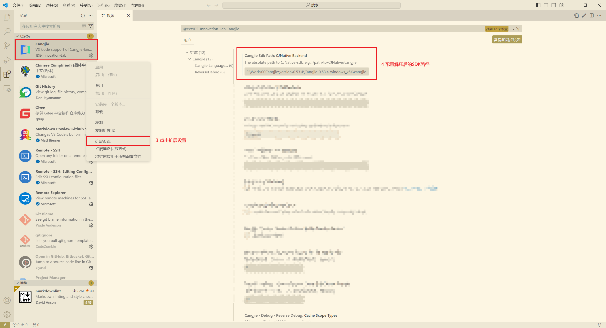

路径层次如下图：

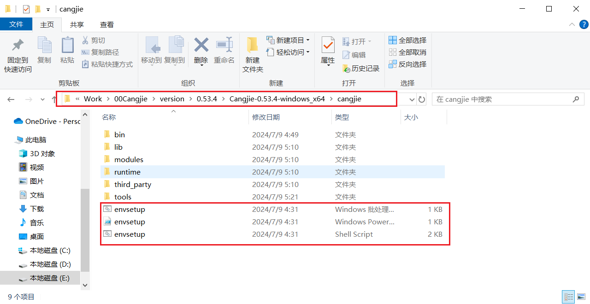

### 2.4 初始化工程

`Ctrl + Shift + P` 打开VScode功能搜索栏，输出 `Cangjie`，选择 `Create Cangjie Project`

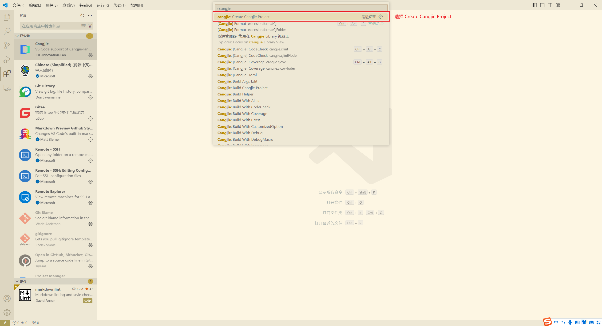

根据提示初始化仓颉项目（CJNative），如下图名为 demo 的仓颉工程

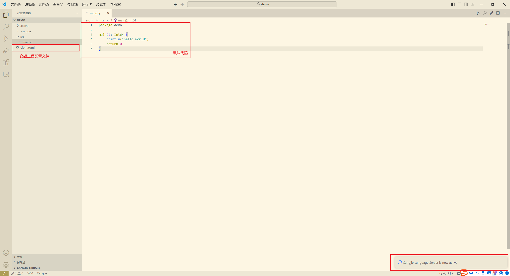

配置文件字段详细说明详见[仓颉编程语言通用版本官方文档](https://gitcode.com/Cangjie/CangjieDocs/overview) （通过申请后可见）《仓颉语言工具使用指南》-仓颉语言命令行工具使用指南-包管理工具-模块配置文件说明

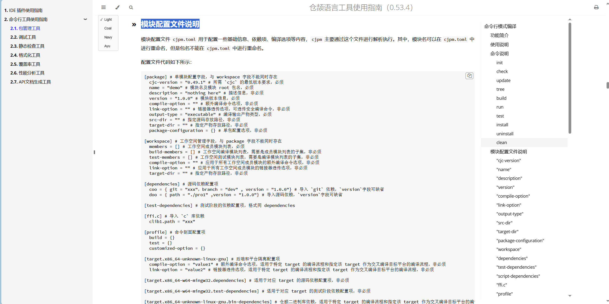

### 2.5 编译运行

右上角三角按钮编译运行，或使用`cjpm run`运行

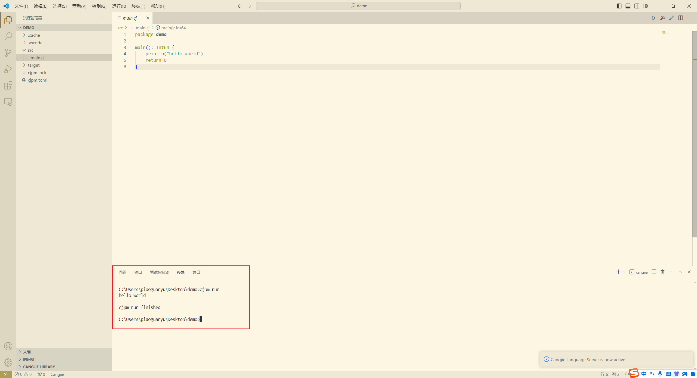

恭喜您编译运行了第一仓颉程序

### 2.6 相关资源

[仓颉编程语言入门教程](https://developer.huawei.com/consumer/cn/training/course/slightMooc/C101718903607800132)

## 3 仓颉鸿蒙应用开发环境搭建（以 Windows 平台为例）

### 3.1 下载 DevEco Studio NEXT Developer Beta2 以及 DevEco Studio NEXT Developer Beta2-Cangjie Plugin.

IDE下载这里不做赘述（推荐下载DevEco Studio NEXT Developer Beta2(5.0.3.500)），点击[DevEco Studio NEXT Developer Beta2-Cangjie Plugin 下载链接](https://developer.huawei.com/consumer/cn/download/) （HarmonyOS NEXT 仓颉语言开发者预览版申请后可见）

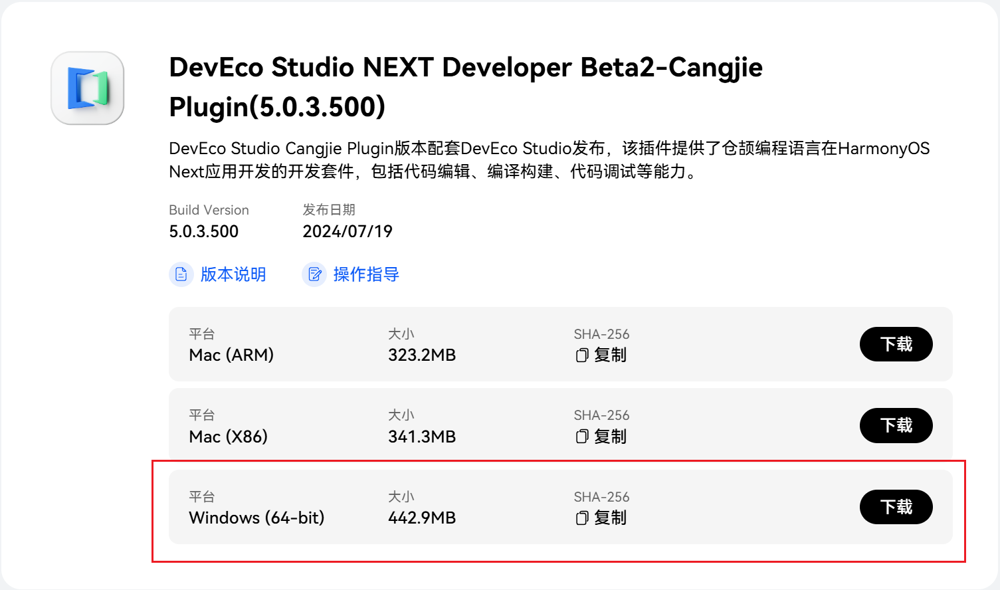

### 3.2 配置环境

打开 DevEco Studio 选择 `Customize`，选择 `All settings...`

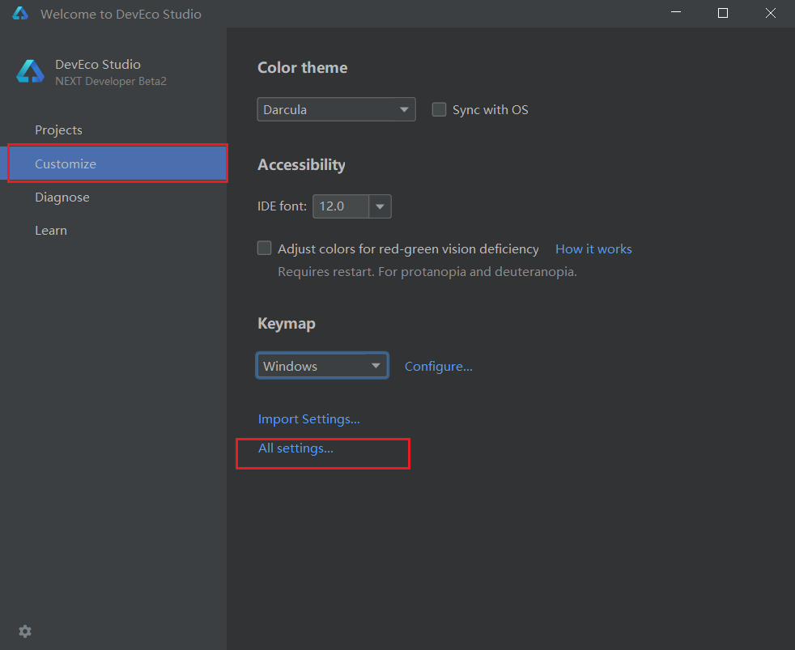

选择 `Plugins`，选择 `install Plugin from Disk...`

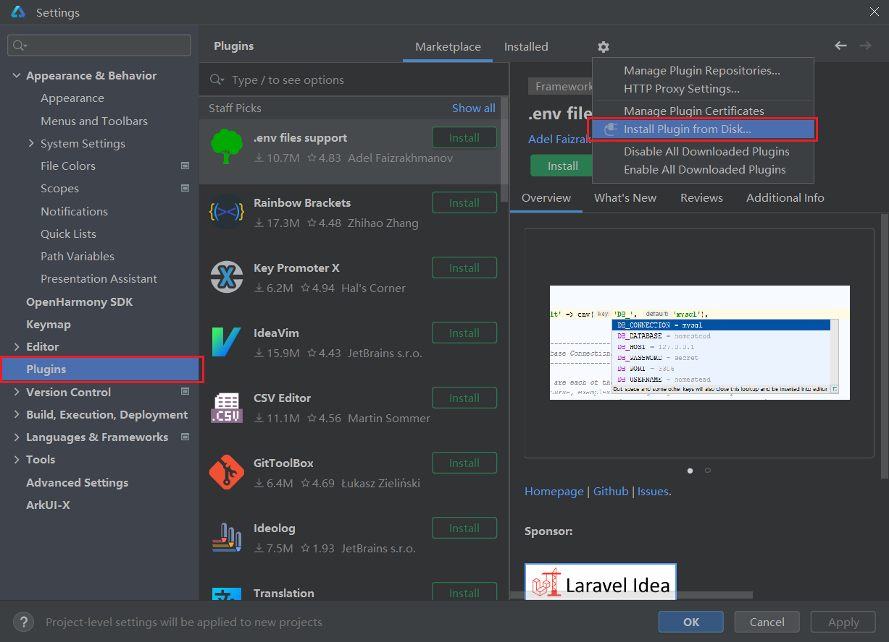

选中下载的 DevEco Studio NEXT Developer Beta2-Cangjie Plugin 压缩包，进行安装

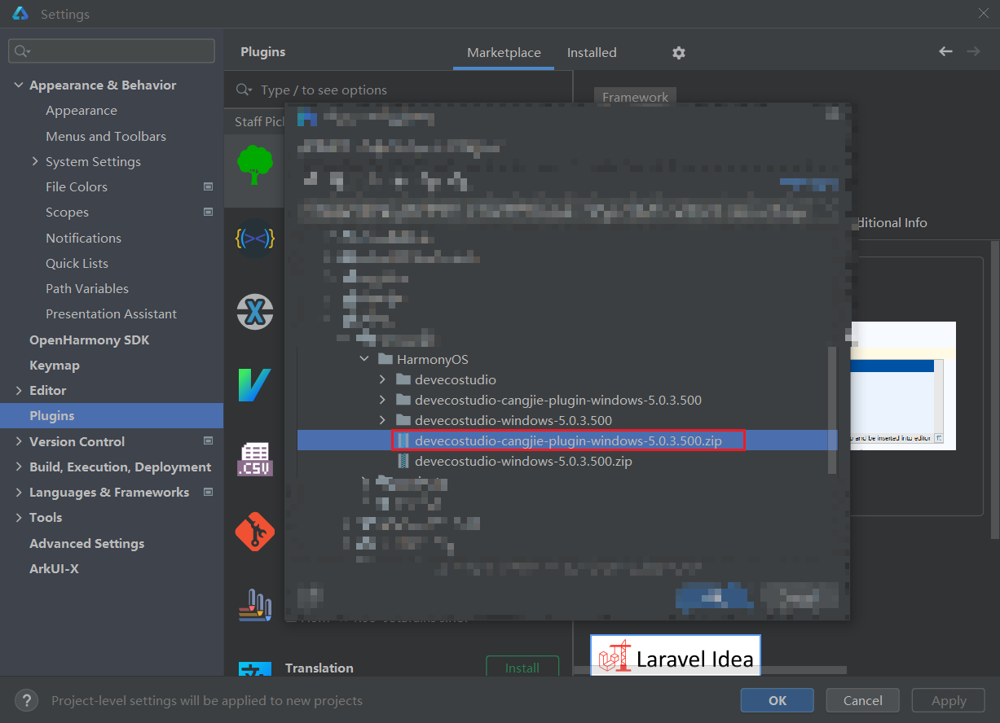

安装结束后点击 Restart IDE，完成安装

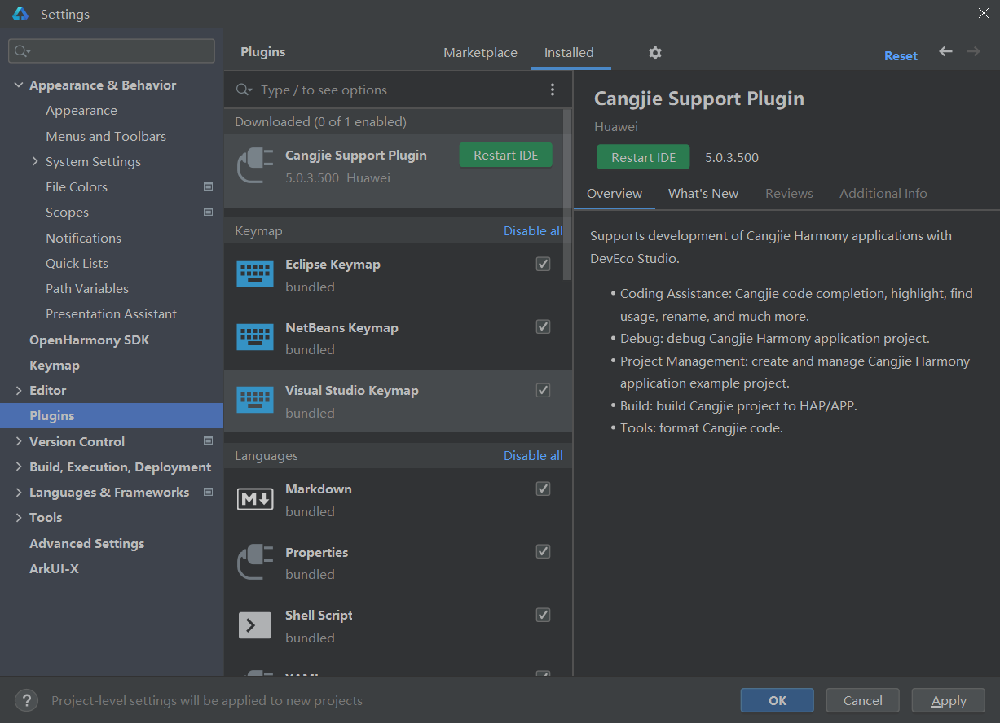

### 3.3 初始化工程

回到创建工程界面，选择 `Create Project`

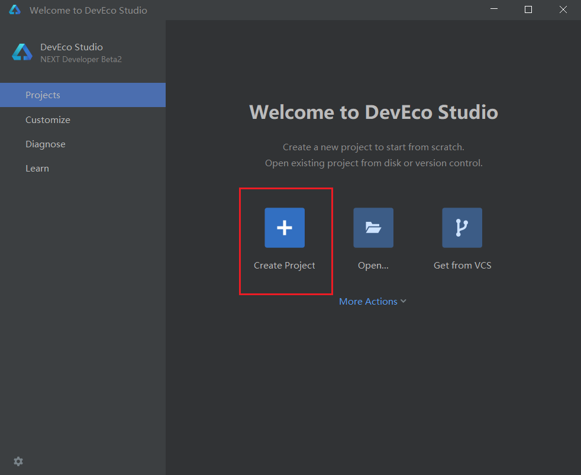

选择 `[Cangjie]Empty Ability`

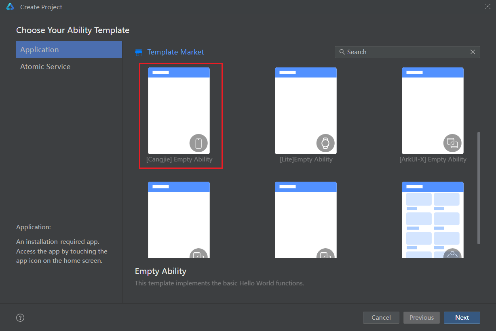

工程初始化成功

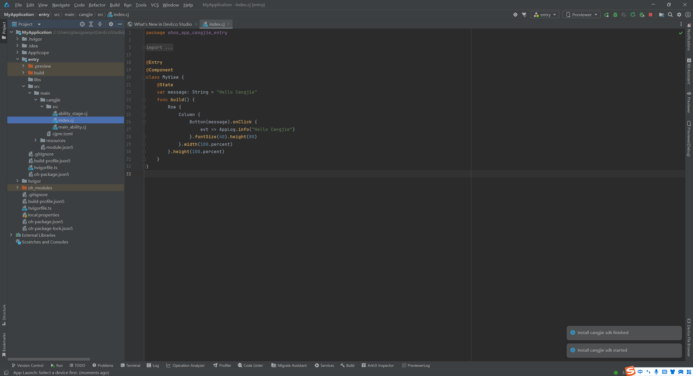

### 3.4 编译运行

手机系统镜像要求：NEXT.0.0.31及以后
IDE模拟器已支持仓颉

### 3.5 相关资源

[HarmonyOS NEXT Developer Beta2 - 仓颉（仓颉鸿蒙应用开发文档）](https://developer.huawei.com/consumer/cn/doc/cangjie-guides-V5/2_1_u5feb_u901f_u5165_u95e8-V5)（HarmonyOS NEXT 仓颉语言开发者预览版申请后可见）

[仓颉UI开发入门课程](https://developer.huawei.com/consumer/cn/training/course/slightMooc/C101720786490569532)（HarmonyOS NEXT 仓颉语言开发者预览版申请后可见）