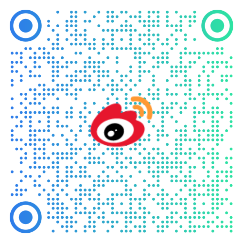

仓颉编程语言是面向全场景智能的新一代编程语言，具有原生智能化、天生全场景、高性能和强安全等特征，适用于端云各种场景下的应用程序开发，并为开发者提供良好的编程体验。

## 源码仓
仓颉编程语言已开源编译器、运行时和标准库，同时提供SDK集成构建指导书、测试用例和测试框架，帮助开发者自主编译构建SDK。欢迎各位开发者参与仓颉社区建设，点击了解[如何贡献](https://gitcode.com/Cangjie/CangjieCommunity/blob/main/contribute/contribution.md)。
- [**cangjie_compiler**](https://gitcode.com/Cangjie/cangjie_compiler )：仓颉编译器源码及 cjdb 调试工具。
- [**cangjie_runtime**](https://gitcode.com/Cangjie/cangjie_runtime)：仓颉编程语言运行时与标准库。
	- [仓颉运行时](https://gitcode.com/Cangjie/cangjie_runtime/tree/main/runtime)
    - [仓颉标准库（含API手册）](https://gitcode.com/Cangjie/cangjie_runtime/tree/main/stdlib)
- [**cangjie_tools**](https://gitcode.com/Cangjie/cangjie_tools)：仓颉编程语言命令行工具，包括仓颉包管理工具、仓颉格式化工具、仓颉多语言桥接工具及仓颉语言服务。
- [**cangjie_stdx**](https://gitcode.com/Cangjie/cangjie_stdx)：仓颉编程语言提供了 stdx 模块，该模块提供了网络、安全等领域的通用能力。
- [**cangjie_build**](https://gitcode.com/Cangjie/cangjie_build)：仓颉SDK集成构建指导书。
- [**cangjie_doc**](https://gitcode.com/Cangjie/cangjie_docs)：仓颉编程语言开发者文档。
- [**llvm-project**](https://gitcode.com/Cangjie/llvm-project)：LLVM 项目是一个模块化、可复用的编译器及工具链技术的集合。此fork用于添加仓颉编译器的功能，并支持仓颉编译器项目。
- [**cangjie_test**](https://gitcode.com/Cangjie/cangjie_test)：仓颉编程语言测试用例。
- [**cangjie_test_framework**](https://gitcode.com/Cangjie/cangjie_test_framework)：方舟编译器测试框架fork，用于仓颉编程语言测试用例的自动化执行。

## 资源平台

- [**仓颉编程语言官网**](https://cangjie-lang.cn)：通用工具链，学习资源，在线体验，新闻资讯
- [**鸿蒙开发者网站仓颉主页**](https://developer.huawei.com/consumer/cn/cangjie)：仓颉鸿蒙应用开发工具链，学习资源
- [**仓颉开源三方库**](https://gitcode.com/Cangjie-TPC)：综合质量获社区认证的开源三方库，欢迎试用和贡献
- [**社区优质开源项目**](./社区优质开源项目.md)：收集和展示仓颉社区优质开源项目

## 通用版本

仓颉通用版本工具链适配三大系统平台（支持 `arm64` 与 `x86-64` 目标），可用于开发 PC 或服务器上的应用程序，目前推荐用 VSCode 及仓颉包管理工具（cjpm）辅助开发，仓颉专属 IDE 也正在开发和内测中，敬请期待。

- **仓颉通用版本当前提供LTS与STS版本**，版本公告请查看[仓颉社区版本生命周期管理规范](https://gitcode.com/org/Cangjie/discussions/129)
	- [**长期稳定版本（LTS）**](https://cangjie-lang.cn/download/1.0.4)：仓颉语言长期稳定版本，在官网直接下载
	- [**稳定版本（STS）**](https://cangjie-lang.cn/download/0.53.18)：每半年发布的较稳定版本，在官网直接下载
- [**示例代码**](https://gitcode.com/Cangjie/Cangjie-Examples/overview)：收集小而美的案例代码，带你在趣味实践中快速入门，也欢迎来此分享你的妙趣设计
- [**开发者论坛**](https://gitcode.com/Cangjie/UsersForum)：通用版本相关问题反馈平台，欢迎各位开发者在此反馈 BUG、需求和改进建议等

下载安装通用版本的详细指导请参考[通用版本获取与安装配置指南](https://gitcode.com/Cangjie/CangjieCommunity/blob/main/%E9%80%9A%E7%94%A8%E7%89%88%E6%9C%AC%E8%8E%B7%E5%8F%96%E4%B8%8E%E5%AE%89%E8%A3%85%E9%85%8D%E7%BD%AE.pdf)

## 鸿蒙版本

仓颉鸿蒙版本工具链，用于开发鸿蒙原生应用，目前处于内测及试点商用阶段，欢迎您试用，[申请开通内测权限](https://developer.huawei.com/consumer/cn/activityDetail/cangjie-beta/)后，可以访问如下资源：

- [**DevEco 仓颉插件**](https://developer.huawei.com/consumer/cn/download/)：下载插件，在对应版本的 DevEco Studio 中安装，即可支持仓颉鸿蒙原生应用开发
- [**开发指南**](https://developer.huawei.com/consumer/cn/doc/cangjie-guides-V5/cj-first-cangjie-app-V5)：学习仓颉鸿蒙开发工具链基本用法，构建第一个鸿蒙应用
- [**API 文档**](https://developer.huawei.com/consumer/cn/doc/cangjie-references-V5/1__u4ed3_u9889api-V5)：系统 SDK 及 UI 组件接口文档
- [**示例应用**](https://gitcode.com/Cangjie/HarmonyOS-Examples/overview)：收集小而美的案例代码，带你在趣味实践中快速入门，也欢迎来此分享你的妙趣设计
- [**开发者论坛**](https://gitcode.com/Cangjie/CangjieMoBileUsersForm)：鸿蒙版本相关问题反馈平台，欢迎各位开发者在此反馈 BUG、需求和改进建议等

下载安装鸿蒙版本的详细指导请参考[鸿蒙版本获取与安装配置指南](https://gitcode.com/Cangjie/CangjieCommunity/blob/main/%E9%B8%BF%E8%92%99%E7%89%88%E6%9C%AC%E8%8E%B7%E5%8F%96%E4%B8%8E%E5%AE%89%E8%A3%85%E9%85%8D%E7%BD%AE.pdf)

## 社区活动

- [**Workshop**](https://gitcode.com/Cangjie/CangjieCommunity/blob/main/Workshop/workshop.md)：每月举办的开发者线上交流会，欢迎来这里分享和倾听关于仓颉的妙语哲思（[查看往期回顾](https://gitcode.com/Cangjie/CangjieCommunity/tree/main/Workshop/%E7%AC%AC32%E6%9C%9FWorkshop)）
- [**技术分享**](./技术分享.md)：不定期举办或参与各种技术大会，由内外部专家分享仓颉相关的语言设计、编译器实现及应用技术
- [**开源毕设**](https://edu.chancefoundation.org.cn/actualCombatList)：开源创新教育联盟平台发布了一批仓颉开源项目课题，可以作为相关专业的毕设课题，欢迎高校师生们选题挑战（打开页面后，搜索“仓颉”筛选）
- [**三方库招募**](https://gitcode.com/Cangjie-TPC/TPC-Resource/blob/main/TPC-LIST.md)：由 [Cangjie-TPC](https://gitcode.com/Cangjie-TPC) 社区发起的优质三方库招募活动，欢迎任意形式的[贡献行为](https://gitcode.com/Cangjie-TPC/TPC-Resource/blob/main/HowToContribute.md)，期待创作和分享，欢迎通过贡献行为提升个人/组织影响力
- **示例程序招募**：欢迎向 [Cangjie-Examples](https://gitcode.com/Cangjie/Cangjie-Examples/overview) 仓和 [HarmonyOS-Examples](https://gitcode.com/Cangjie/HarmonyOS-Examples/overview) 仓贡献妙趣的示例程序，帮助社区新人快速入门，同时展现你的高超水平，示例程序设计要追求生动、有趣、深刻、典型，编码与文档要规范优雅

## 合作联系

官方邮箱：cangjie@huawei.com

产业合作：仓颉生态与产业发展总监[@王学智](https://gitcode.com/wangxuezhi355) | [@朴冠羽](https://gitcode.com/seansonlight) | [@徐天宇](https://gitcode.com/xutianyu)

学研合作：[@刘俊杰](https://gitcode.com/EastGreatSummer) | [@许亦然]()

营销宣传：[@刘威](https://gitcode.com/liuwei503388) | [@王可欣]()

运营活动：[@赵丹荣](https://gitcode.com/Leporide) | [@朴冠羽](https://gitcode.com/seansonlight)

## 仓颉官方号

