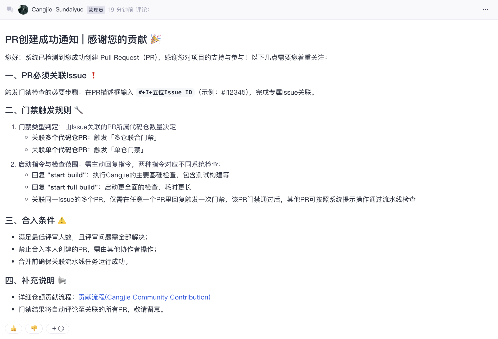
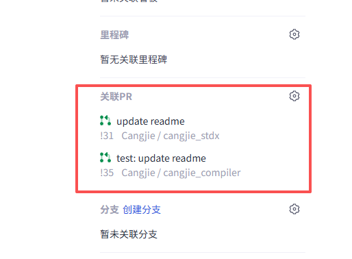
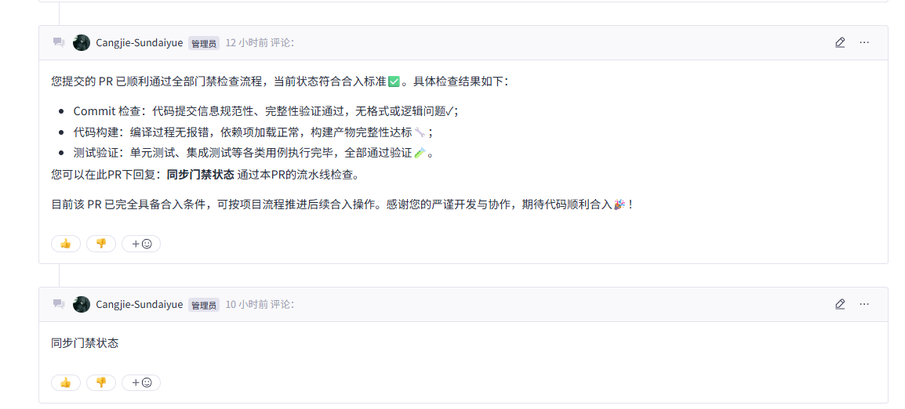
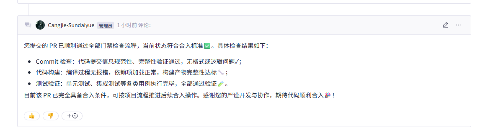
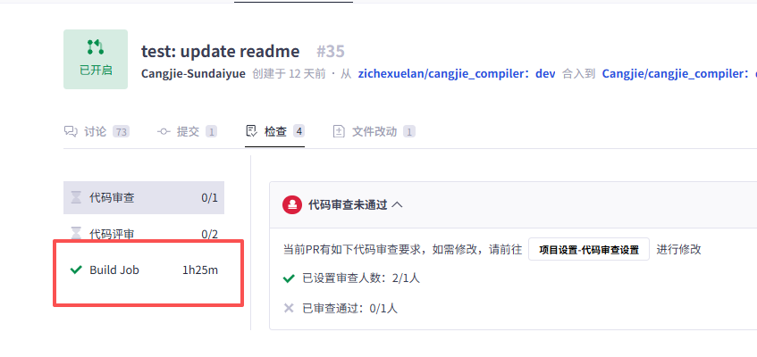

# 贡献流程<a name="ZH-CN_TOPIC_0000001052970939"></a>

## 环境准备<a name="section124971410183614"></a>

-   针对Git的安装、环境配置及使用方法，请参考GitCode帮助中心的Git知识大全：[https://docs.gitcode.com/docs/help/home/general-reference/git](https://docs.gitcode.com/docs/help/home/general-reference/git)
-   注册SSH公钥，请参考GitCode帮助中心的公钥管理：[https://docs.gitcode.com/docs/help/home/user_center/security_management/ssh](https://docs.gitcode.com/docs/help/home/user_center/security_management/ssh)
-   在开展GitCode的工作流之前，您需要先在Cangjie的代码托管平台上找到您感兴趣的Repository。

## 代码下载<a name="section6125202333611"></a>

### 从云上Fork代码分支<a name="section8365811818"></a>

1.  找到并打开对应Repository的首页。
2.  点击右上角的 Fork 按钮，按照指引，建立一个属于**个人**的云上Fork分支。

###  把Fork仓下载到本地<a name="section49051646201819"></a>

请按照以下的过程将Repository内的代码下载到您的在计算机上：

1.  **创建本地工作目录**：

    您需要创建本地工作目录，以便于本地代码的查找和管理

    ```
    mkdir ${your_working_dir}
    ```

2.  **复制远程仓库到本地**
    1.  **切换到本地路径**

        ```
        mkdir -p ${your_working_dir}
        cd ${your_working_dir}
        ```

    2.  **复制远程仓库到本地**
        -   您可以在仓库页面内复制远程仓库的拷贝地址，得到`$remote\_link`：

            **图 1**  复制远程仓库
            
            

        -   在本地电脑执行拷贝命令：

            ```
            git clone $remote_link
            ```

### 代码提交\(git clone场景\)<a name="section669715742719"></a>

1.  **拉分支**

    更新您的本地分支

    ```
    git remote add origin $remote_link
    git fetch origin
    git checkout master  
    git pull --rebase 
    ```

    基于远端master分支拉取本地调试分支

    ```
    git branch myfeature origin/master
    git checkout myfeature  
    ```

    然后在myfeature分支上编辑和修改代码。

2. **在本地工作目录提交变更**

   ```
   git add .
   git commit -sm  "feat: xxx"  // 提交信息包含signoff邮箱
   ```
   您可能会在前次提交的基础上，继续编辑构建并测试更多内容，可以使用commit --amend继续添加提交。
   提交信息采用 [Conventional Commits（约定式提交规范）](https://www.conventionalcommits.org/zh-hans/v1.0.0/)，一个复杂点的 commit 格式参考如下：
   ```
   feat: add some new features

   Add xx feature for xxx, it can xxxx.

   Add xx feature for xxx, it can xxxx.

   Refs: #12
   ```
   
   更多 commit 风格信息参考[Conventional Commits（约定式提交规范）](https://www.conventionalcommits.org/zh-hans/v1.0.0/)。

3.  **将变更推送到您的远端目录**

    准备进行审查（或只是建立工作的异地备份）时，将分支推到您的fork仓库:

    ```
    git push -f origin myfeature
    ```

## Pull Request与门禁操作<a name="section28261522124316"></a>

### 完整流程概览


### 关键步骤说明

1. **基础准备**

- Fork 目标仓库，拉取至本地。
- 基于仓库dev分支开发，代码修改完成后提交到 Fork 仓。
- 仓库列表：
    - https://gitcode.com/Cangjie/cangjie_compiler    # 仓颉编译器仓库
    - https://gitcode.com/Cangjie/cangjie_runtime     # 仓颉运行时仓库
    - https://gitcode.com/Cangjie/cangjie_tools       # 仓颉工具链仓库
    - https://gitcode.com/Cangjie/cangjie_stdx        # 仓颉标准库仓库
    - https://gitcode.com/Cangjie/llvm-project        # LLVM项目仓库（仓颉依赖）
    - https://gitcode.com/Cangjie/cangjie_test        # 仓颉测试用例仓库
    - https://gitcode.com/Cangjie/cangjie_test_framework  # 仓颉测试框架仓库

2. **Issue与PR创建**

- 创建 Issue：任意仓库即可

- 创建 PR：
    - 单仓修改：从个人仓库分支向目标仓库dev分支创建 PR。
    - 多仓修改：为涉及的每个仓库分别创建 PR。
    
- 可在下方看到系统回复提示：

    

3. **PR关联操作**

- 在 Issue 选择并关联 PR。

- 多仓修改时，多个仓的所有 PR 需关联同一个 Issue（请避免同一个仓的多个 PR 关联至同一个 Issue）。

  

4. **门禁触发**

- 门禁类型判定：
    - 多仓联合门禁：关联同一个 Issue 的 PR 会联合构建，如cangjie_compiler、cangjie_runtime、cangjie_test三个仓的三个 PR 关联了同一个 Issue，那么在运行门禁时，它们会进行联合构建和测试。
    
- 触发方式：在任意关联 PR 的评论区回复指令：
    - （推荐）回复 "**start build**"：执行 Cangjie 的主要基础检查，包含测试、构建等
    
    - （内测中）回复 "**start full build**"：启动更全面的检查，耗时更长
    
      
    
- 多仓触发规则：
    - 多个仓库仅需在**任意 1 个**关联 **PR** 中**回复 1 次指令**，结果将会同步至所有关联 PR，结果见 PR 内回复提示
    
    - （注意：若其他仓的 PR 流水线状态为未通过，可按照回复提示在 PR 内留言："**sync ci status**"，即可通过 PR 的流水线检查）
    
    - 创建 PR、更新代码、重新打开 PR，系统**不会**自动触发门禁，需要重新回复触发 CI 门禁。
    
      
    
- 门禁内容：
    - Codecheck
    - Commitlint格式检查
    - linux/windows/mac平台的构建和HLT、LLT测试。

5. **PR 合入条件**
- 所有关联 PR 的门禁检查结果为 “成功”。
- 满足最低评审人数要求，且评审意见已解决。
- 由他人合入 PR，不可自行合入自己创建的 PR。

​	


